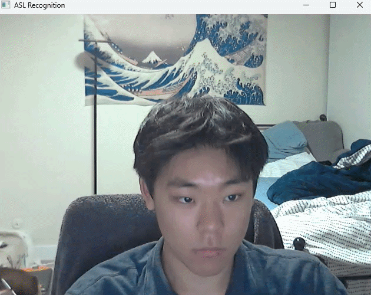

# Auto Slug ASL Translator

## On Boarding
### Downloading Requirements
(Windows)
create a virtual enviroment with python -m venv .venv
Enter the venv with source .venv/bin/activate
Then run pip install -r requirements.txt

### Homework
Submit a pr and commit a message on the README so we know you know git
- Alex Knows how to use Github

<!-- DATA_COUNTS_START -->
## Dataset Summary

| Label | Samples |
|-------|---------|
| A | 1035 |
| B | 1029 |
| c | 1040 |
| d | 1211 |
| e | 1028 |
| f | 1015 |
| g | 1098 |
| h | 1020 |
| i | 1039 |
| k | 1039 |
| l | 1041 |
| **Total** | **11595** (11 labels) |
<!-- DATA_COUNTS_END -->
